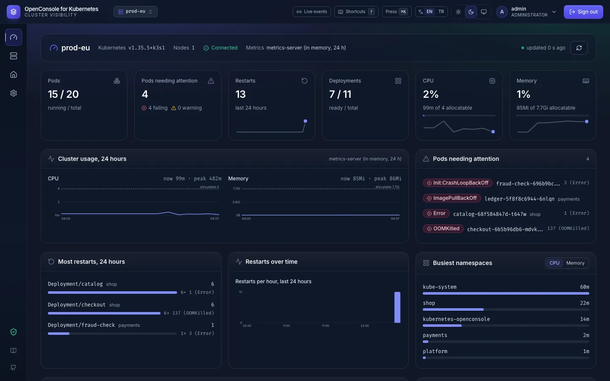
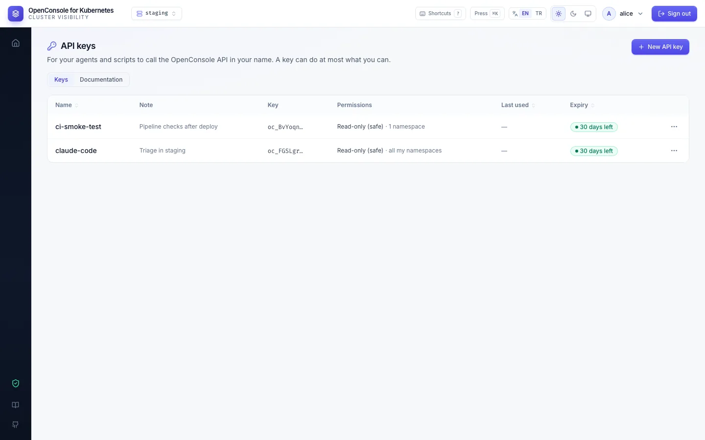

Kubernetes OpenConsole gives a platform team one place to inspect workloads across several clusters, grant namespace-scoped access and review what users did. Developers and on-call engineers can read logs, investigate failing pods and perform the operations their roles allow, without receiving the clusters' kubeconfigs.

The **2.23 documentation** also covers scripts and AI agents. Scoped API keys use the same resource permissions as the web interface, with an additional administrator policy controlling what those keys may reach.

The distinction matters: **the current console is not read-only by default at the Kubernetes identity level**. Restart, scale, YAML editing, pod shells and Secret access depend on application grants, feature flags and the permissions of the identity used to connect each cluster. A separate read-only Kubernetes RBAC manifest is available when the console should only observe.

[Read the documentation](https://k8sopenconsole.github.io/) · [Türkçe dokümantasyon](https://k8sopenconsole.github.io/tr/) · [Source and releases](https://github.com/vurulkan/kubernetes-openconsole).

This guide follows the published **2.23** documentation and **2.23.0** image. The screenshots come from the documentation project's demo environment; the workloads and users shown are fictional.

## What the current console includes

### Cluster and workload visibility

- A multi-cluster selector remembered separately for each user, with an administrator-defined default.
- An administrator Overview for pod health, workload restarts, cluster usage, warning events and nodes.
- An administrator-only, read-only Nodes screen with capacity, allocatable resources, conditions, taints, events and the pods running on each node.
- Pods, Deployments, StatefulSets, DaemonSets, HPAs, Services, ConfigMaps, Secrets, Ingresses, CronJobs and Jobs in the Dashboard.
- Detail drawers for workloads and pods, including container state, requests and limits, rollout conditions, related events and restart explanations.
- Configurable list columns, search across displayed fields and label filters. Pod rows can show per-container state and the direct controller in the Containers and Controlled By columns.

List endpoints use a `client-go` informer cache. Live Events stream changes over WebSocket rather than relying on repeated full-page refreshes.

{: width="1440" height="900" loading="lazy" .normal }
_The administrator Overview brings pod health, usage and restart history together. Screenshot from the OpenConsole documentation._

### Troubleshooting and observability

Pod, Deployment and Job logs support container selection, the previous container instance, live follow, search, pause, wrapping, copy and download. Streams reconnect and follow restarting containers.

CPU and memory usage come from metrics-server. Short-term usage history is kept in memory; a configured Prometheus source provides longer history, up to seven days. Container exit history is retained separately, including exits for pods that no longer exist.

The console also exposes Prometheus metrics, structured JSON logging and optional OpenTelemetry tracing. `/livez` checks the process and `/readyz` checks the database; one unavailable cluster does not make the console itself unready.

### Controlled operations

| Capability | Application permission |
|---|---|
| Restart a Deployment | `deployments:restart` |
| Scale a Deployment or StatefulSet | `deployments:scale`, `statefulsets:scale` |
| Edit workload YAML with diff, server dry-run and apply | `{resource}:edit` |
| Open a pod shell | `pods:exec` |
| Read Secret metadata or reveal a value | `secrets:list`, `secrets:get`, `secrets:reveal` |
| Edit a Secret | `secrets:edit` |

Write operations are opt-in for regular users through role permissions, scoped by namespace and cluster. Administrators implicitly have application permissions, but Kubernetes RBAC and operator feature flags still limit what can run.

Web pod-shell sessions are recorded as asciicast files by default and can be replayed by administrators. Recording settings include retention, size limits, total quota and disk-pressure policy. A web shell can continue without recording when recording is disabled or unavailable; a command or shell opened with an API key must be recorded and is refused when the recorder cannot accept it. A recording can contain credentials printed in the terminal, so recordings need the same care as the audit database.

## Architecture and permission boundaries

- **Backend:** Go, `client-go`, chi, structured logging and SQLite.
- **Frontend:** React, TypeScript and Vite, with a YAML editor, WebSocket terminal and recording player.
- **Deployment:** one container, with persistent data under `/data`.

The application uses one configured identity per cluster. End users do not receive individual Kubernetes identities: OpenConsole evaluates their groups, roles and namespace/cluster grants in the application layer. The API server independently limits the shared identity through Kubernetes RBAC.

The pod does **not** automatically adopt its mounted ServiceAccount or discover a cluster from an environment variable. Connections are added in **Admin → Clusters**, using a ServiceAccount token or a supported kubeconfig. Avoid personal administrator kubeconfigs; exec-plugin authentication is not supported by the container.

## Choose an image

The published 2.23 documentation pins release `2.23.0`:

```yaml
image: ghcr.io/vurulkan/kubernetes-openconsole:2.23.0
```

Release images support `linux/amd64` and `linux/arm64`. Pin a release for a reproducible installation. `latest` follows published releases; development images use separate `dev-*` tags. Release images include GitHub build-provenance and SBOM attestations; verification commands are in the repository README.

To build your own image from a checked-out repository:

```bash
docker build -t kubernetes-openconsole:local .
```

## Try it locally

```bash
docker run --rm -p 127.0.0.1:8080:8080 \
  -e TIMEZONE=Europe/Istanbul \
  -v kubernetes-openconsole-data:/data \
  ghcr.io/vurulkan/kubernetes-openconsole:2.23.0
```

Open `http://localhost:8080`. The named volume preserves the SQLite database and recordings. This starts the console; cluster access is configured through the UI afterwards.

The cluster API must be reachable from inside this container. A kubeconfig endpoint at `127.0.0.1` refers to the container itself there. For a local cluster, use the network and endpoint described in the [Docker quick start](https://k8sopenconsole.github.io/getting-started/quick-start) or the [k3d walkthrough](https://k8sopenconsole.github.io/getting-started/try-on-k3d).

## Deploy to Kubernetes

Use a small Kustomize directory that pins both the release manifests and the image. Save this as `kustomization.yaml`:

```yaml
apiVersion: kustomize.config.k8s.io/v1beta1
kind: Kustomization
resources:
  - https://github.com/vurulkan/kubernetes-openconsole//deploy?ref=v2.23.0
images:
  - name: ghcr.io/vurulkan/kubernetes-openconsole
    newTag: "2.23.0"
patches:
  - patch: |-
      apiVersion: apps/v1
      kind: Deployment
      metadata:
        name: kubernetes-openconsole
        namespace: kubernetes-openconsole
      spec:
        strategy:
          type: Recreate
          rollingUpdate: null
```

Apply that directory:

```bash
kubectl apply -k .
kubectl -n kubernetes-openconsole rollout status deploy/kubernetes-openconsole --timeout=5m
```

Before applying, review the manifests for your environment:

- The source manifest uses `latest`; the `images` override pins the container to the same release as `ref=v2.23.0`.
- Keep **exactly one replica** and the **`Recreate` strategy**. In 2.23.0, overlapping pods can open the same SQLite database and lose writes. `Recreate` stops the old pod before starting its replacement, including during a rollout restart.
- The default PVC is 5 Gi and stores both the database and recordings. Plan capacity and backups accordingly.
- The Service exposes port 80 to container port 8080. Put your own Ingress or Gateway in front of it.
- The deployment runs without an automatically mounted ServiceAccount token. Cluster credentials are supplied through the UI.
- The default `rbac.yaml` includes write permissions despite the `openconsole-readonly` ClusterRole name. For an observation-only installation, follow the documentation's [read-only installation variant](https://k8sopenconsole.github.io/installation/kubernetes) and explicitly select `rbac-readonly.yaml` instead of the full deploy directory. Reapplying the full directory would restore `rbac.yaml`.

The read-only manifest removes write operations and excludes Secrets. Logs remain available. Do not grant write or exec actions in application roles when the underlying Kubernetes identity cannot perform them.

The [Kubernetes installation guide](https://k8sopenconsole.github.io/installation/kubernetes) also covers TLS ingress and WebSocket timeouts. Logs, shells and Live Events need connections that survive the proxy's idle timeout. Keep the unauthenticated `/metrics` endpoint on the internal monitoring path.

## First login and cluster connection

On first startup, log in with `admin` / `admin` and complete the required password change. Sign in again with the new password afterwards; pages and API calls remain unavailable until the initial change is complete.

Then:

1. Open **Admin → Clusters → Add Cluster**.
2. Choose **ServiceAccount Token** or **Kubeconfig**.
3. Supply an API endpoint reachable from the OpenConsole backend and the matching CA certificate and credentials.
4. Save the cluster to validate the connection, then set a default if appropriate.
5. Create roles and their cluster/namespace permissions, assign the roles to groups, then add users to those groups.

When OpenConsole runs inside Kubernetes, that cluster's API endpoint can be `https://kubernetes.default.svc`. Remote clusters need their own reachable endpoint and identity. The [cluster connection guide](https://k8sopenconsole.github.io/installation/connect-cluster) includes token/CA extraction, supported kubeconfigs and token rotation; generated credentials should never be committed to Git.

## Users, identity and audit

Local users, LDAP/Active Directory and single-tenant Azure AD / Entra ID login are configured in the UI. LDAP supports search, import and first-login provisioning according to its configured rules.

Roles can use Viewer, Developer, SRE and Admin permission templates, or individual grants. Users without the required group and role assignments do not gain access merely by signing in. Each user switches only their own active cluster.

One useful detail from the [first-login checklist](https://k8sopenconsole.github.io/getting-started/first-login): the **Viewer** template provides `list` and `get`, including Secret metadata, but does **not** include logs. Add `pods:logs` explicitly where viewers need them. Regular users receive roles through groups; the initial administrator should also create a personal admin account so audit entries identify a person.

Audit records include the actor, action, target cluster, namespace/resource, outcome and operation details. Failed and denied actions are recorded as well. Audit filters and CSV export support access reviews. Administrators can list and revoke sessions and review shell recordings.

## Scoped API keys for scripts and AI agents

OpenConsole exposes a REST API described by OpenAPI 3.1 at `/api/openapi.json`. Users create keys from their account menu under **API keys**, selecting a cluster scope, namespaces, permissions and expiry. The secret is displayed once and stored as a hash.

{: width="1440" height="900" loading="lazy" .normal }
_Users manage keys for scripts and agents from their own account. Screenshot from the OpenConsole documentation._

A request must fit all of these limits:

1. The key's selected clusters, namespaces and permissions.
2. The permissions its owner currently holds.
3. The administrator's API access policy.
4. The operator's feature flags and the connected Kubernetes identity's RBAC.

For regular roles, **Safe read-only** is the default API policy: `list`, `get` and `logs`, excluding ConfigMaps and Secrets. Administrators can set a role to **Off** or **All of the role's permissions**, and apply a per-user override. The policy is checked at request time, so a key can lose access when the owner's grants or the policy change.

The **Read-only (safe)** key template is a useful starting point for an agent that should inspect pods and logs. The broader **Read-only (all)** template can include ConfigMap data and Secret values; choose it only when that access is intended. Admin endpoints require a separately selected **Admin API** scope on an administrator's key. Key management, password changes and other web-only actions remain unavailable to keys.

### First API calls

Create a key in the UI, then enter it in a local Bash session. Replace the example URL, cluster and namespace with your own:

```bash
export OC_URL='https://openconsole.example.com'
export OC_CLUSTER='staging'
read -rsp 'OpenConsole API key: ' OPENCONSOLE_API_KEY
export OPENCONSOLE_API_KEY
printf '\n'

curl -fsS --max-time 30 \
  -H "Authorization: Bearer $OPENCONSOLE_API_KEY" \
  "$OC_URL/api/auth/me"

curl -fsS --max-time 30 \
  -H "Authorization: Bearer $OPENCONSOLE_API_KEY" \
  -H "X-OpenConsole-Cluster: $OC_CLUSTER" \
  "$OC_URL/api/namespaces/shop/pods"
```

Inspect `/api/auth/me` before giving the key to an agent: it reports the key and the permissions/namespaces it can reach now. Set `X-OpenConsole-Cluster` explicitly in scripts so requests target the intended cluster. Resource lists return Kubernetes objects under `items`.

Keep the key in the agent's environment rather than in its prompt, a committed file or a URL. Resource reads and actions are audited with both the user and key name. Commands and shells opened by a key are always recorded; if recording is unavailable they return `503 recording_unavailable`.

The [API quick start](https://k8sopenconsole.github.io/api/quick-start) covers logs, single-command exec and response errors. The [agent recipes](https://k8sopenconsole.github.io/api/agent-recipes) include a shell wrapper and examples for Claude Code and Cursor. These recipes describe tools calling OpenConsole's API; they do not add an autonomous agent inside the console.

## Operator controls

| Setting | Purpose |
|---|---|
| `DATA_PATH` | SQLite location; image default `/data/app.db` |
| `STATIC_DIR` | Frontend assets; image default `/app/public` |
| `TIMEZONE` | Audit timestamp timezone; default UTC |
| `LOG_RETENTION_DAYS` | Audit retention; default 30 days |
| `API_KEY_READ_RETENTION_DAYS` | Successful API-key resource reads; default 7 days |
| `RESTART_HISTORY_RETENTION_DAYS` | Container exit history; default 30 days |
| `MAX_REPLICAS` | Scale endpoint ceiling; default 100 |
| `EXEC_IDLE_TIMEOUT` | Idle pod-shell timeout; default `5m` |
| `MAX_EXEC_SESSIONS_PER_USER` | Concurrent shell limit; default 3 |

Feature flags let operators disable capabilities for everyone, including administrators:

```yaml
- name: FEATURE_POD_EXEC
  value: "false"
- name: FEATURE_YAML_EDIT
  value: "false"
- name: FEATURE_WORKLOAD_ACTIONS
  value: "false"
- name: FEATURE_SECRETS
  value: "false"
- name: FEATURE_API_KEYS
  value: "false"
```

These flags complement Kubernetes RBAC and application grants. They do not replace either. Recording environment variables normally seed settings only on the first startup; later changes belong in **Admin → Recordings → Recording settings**. `SESSION_RECORDING_DIR` is read on each startup.

The [environment variable reference](https://k8sopenconsole.github.io/reference/environment-variables) distinguishes server defaults from image and Deployment values. For example, the deployment sets ECS logging while the server's unset `LOG_FORMAT` default is `text`.

## Everyday use and troubleshooting

The UI supports English and Turkish, light/dark/system themes, saved views, a command palette and keyboard navigation. Shared views carry filters and context, but never grant access to the underlying namespace.

If the console appears empty, check the selected cluster and application permissions first. If a Kubernetes action returns 403, compare both the application grant and the connected identity's ClusterRole. Missing CPU/memory data usually requires checking metrics-server and the relevant metrics API permissions. A connection failure on Save should be investigated from the backend pod's network path and CA configuration.

Keep ServiceAccount permissions limited to the capabilities you actually expose, rotate credentials, and back up the persistent database and recordings. The console is an internal operations tool; its shared cluster identity makes careful permission design essential.

Backups need the same access restrictions as the cluster credentials. The documentation notes that the credentials are encrypted in SQLite but their encryption key is stored in the same database. Follow the [backup and restore procedure](https://k8sopenconsole.github.io/installation/backup-restore), which stops the application before copying the volume, and review the [hardening checklist](https://k8sopenconsole.github.io/operations/hardening) before handing the console to a team.

## Related cluster deployment guides

- [Kubernetes HA on Ubuntu](/posts/ansible-k8s-ha-cluster-ubuntu/)
- [Kubernetes HA on RHEL](/posts/ansible-k8s-ha-cluster-rhel/)
- [Kubernetes HA on Debian](/posts/ansible-k8s-ha-cluster-debian/)

Updated on November 15, 2026 against the [published 2.23 documentation at `8839e18`](https://github.com/k8sopenconsole/k8sopenconsole.github.io/tree/8839e180aeb5fb6ea14cf89e6e723b0681fc2e4d/versioned_docs/version-2.23), whose code reference is `v2.23.0`. The site's published version was used rather than its unreleased Next pages. The commands were checked against that documentation; this article update did not deploy or test a live cluster.

Screenshots are reproduced unchanged from the [Kubernetes OpenConsole documentation project](https://github.com/k8sopenconsole/k8sopenconsole.github.io/tree/8839e180aeb5fb6ea14cf89e6e723b0681fc2e4d/static/img/screens), licensed under [CC BY 4.0](https://creativecommons.org/licenses/by/4.0/). They show the project's fictional demo data. The [full documentation](https://k8sopenconsole.github.io/) remains the reference for deployment details, policy settings and troubleshooting.
